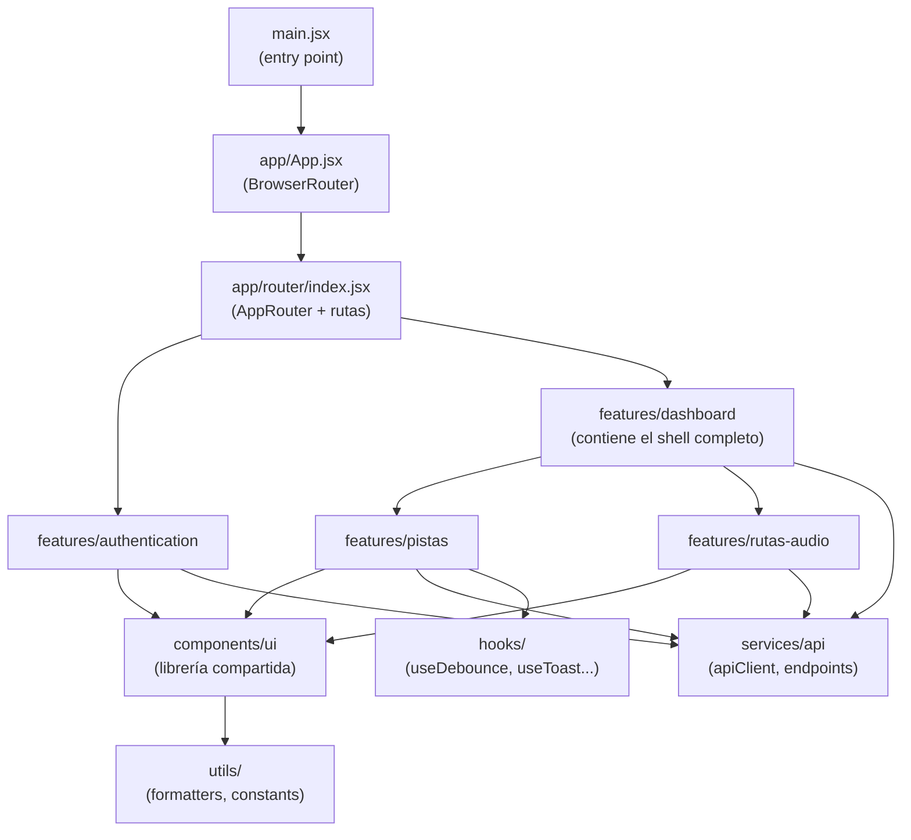
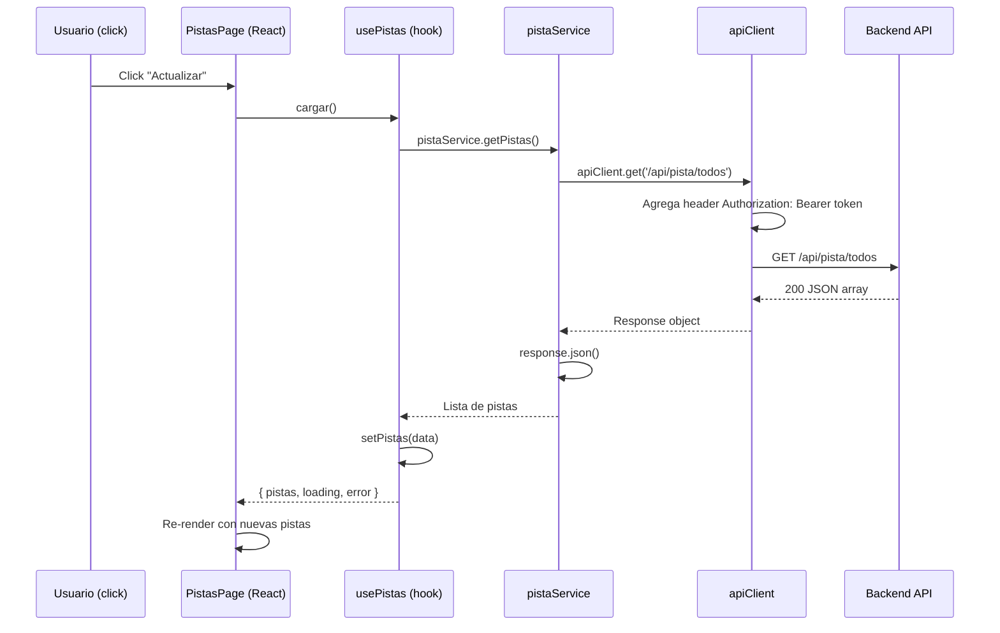

# Arquitectura — Antara Admin

## Feature-Based Architecture

El proyecto sigue una arquitectura basada en funcionalidades (Feature-Based). Cada feature es una carpeta autónoma que contiene su propia página, componentes, hooks y servicios.



---

## Estructura de un feature

Cada feature sigue esta estructura estándar:

```
features/pistas/
├── components/         ← Componentes específicos de este feature
│   ├── MiniPlayer.jsx
│   ├── ModalMetadatos.jsx
│   ├── PistasTable.jsx
│   └── ...
├── hooks/              ← Estado y lógica del feature
│   ├── usePistas.js
│   └── useAudioPlayer.js
├── pages/              ← Página principal del feature
│   └── PistasPage.jsx
├── services/           ← Llamadas a la API del feature
│   └── pistaService.js
└── index.js            ← Exportaciones públicas del feature
```

---

## Reglas de importación (críticas)

> [!IMPORTANT]
> Estas reglas evitan acoplamiento incorrecto entre features.

| Desde | Puede importar de | NO puede importar de |
|---|---|---|
| `features/X/pages/` | `features/X/components/`, `features/X/hooks/`, `features/X/services/`, `components/ui/`, `services/api/`, `hooks/`, `utils/` | Otro feature directamente |
| `features/X/components/` | `components/ui/`, `utils/` | Hooks o servicios de otro feature |
| `features/X/hooks/` | `features/X/services/`, `services/api/`, `hooks/`, `utils/` | Componentes |
| `features/X/services/` | `services/api/`, `utils/` | React, hooks, componentes |
| `components/ui/` | `utils/` | Features, services, hooks |
| `app/router/` | `features/*/index.js`, `app/layouts/` | Servicios, hooks directamente |

**La única excepción válida:** `DashboardPage` importa `PistasPage` y `RutasAudioPage` directamente porque actúa como shell de navegación.

---

## Flujo completo de una acción del usuario



---

## Separación de responsabilidades

| Capa | Responsabilidad | NO hace |
|---|---|---|
| **Página** (`pages/`) | Ensambla hooks y componentes, maneja estado de UI (qué modal está abierto) | Fetch HTTP, lógica de negocio |
| **Hook** (`hooks/`) | Gestiona estado de datos, coordina llamadas al servicio | Renderizar JSX, fetch directo |
| **Servicio** (`services/`) | Llama a `apiClient`, convierte respuesta, lanza errores | Estado React, lógica de UI |
| **Componente** (`components/`) | Renderiza UI, recibe props, emite eventos | Fetch HTTP, estado global |
| **apiClient** | Fetch HTTP, headers, timeout, 401 redirect | Lógica de negocio |

---

## ❌ Errores comunes de arquitectura

- **Hacer `fetch` directamente en un componente.** Todo HTTP va a través de `apiClient` → service → hook.
- **Importar el hook de un feature desde otro feature.** Cada feature es autónomo.
- **Poner lógica de negocio en un componente.** Va en el hook.
- **Crear un archivo `service.js` que no use `apiClient`.** Siempre usa el cliente centralizado.
- **Crear componentes globales en `components/ui/` que solo se usan en un feature.** Van en `features/X/components/`.

