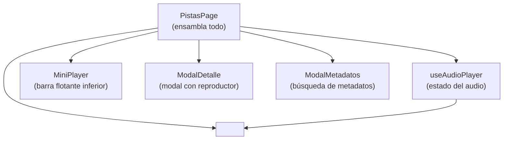

# Reproductor de Audio

## Arquitectura del reproductor



---

## `useAudioPlayer` — API del hook

```js
const {
  audioRef,            // ref al elemento <audio> del DOM
  reproduciendoId,     // Guid de la pista que está en el reproductor
  sonando,             // boolean — ¿está reproduciendo en este momento?
  progreso,            // number — segundos actuales de reproducción
  duracionAudio,       // number — duración total en segundos
  volumen,             // number — de 0 a 1 (persistido en localStorage)
  silenciado,          // boolean — ¿está silenciado?
  alternarReproduccion,// (pista) => void — play/pause de una pista
  detener,             // () => void — para y limpia el reproductor
  buscarTiempo,        // (event) => void — seek (onChange de <input range>)
  cambiarVolumen,      // (event) => void — cambia volumen (onChange de <input range>)
  alternarSilencio,    // () => void — toggle mute
  setSonando,          // dispatch — usado internamente por el <audio>
  setProgreso,         // dispatch — usado por onTimeUpdate del <audio>
  setDuracionAudio,    // dispatch — usado por onLoadedMetadata del <audio>
} = useAudioPlayer({ onToast })
```

---

## Elemento `<audio>` en el DOM

El elemento `<audio>` es invisible y se declara en `PistasPage`. Sus eventos conectan con el hook:

```jsx
<audio
  ref={audioRef}
  className="hidden"
  onPlay={() => setSonando(true)}
  onPause={() => setSonando(false)}
  onTimeUpdate={(e) => setProgreso(e.currentTarget.currentTime || 0)}
  onLoadedMetadata={(e) => {
    const valor = e.currentTarget.duration
    setDuracionAudio(Number.isFinite(valor) ? valor : 0)
  }}
  onEnded={() => {
    setSonando(false)
    setProgreso(0)
  }}
/>
```

> [!IMPORTANT]
> Solo puede haber **un elemento `<audio>`** en la página a la vez. El hook usa `audioRef` para controlarlo directamente. No crees elementos `<audio>` adicionales.

---

## Streaming de audio

El reproductor usa `src = ENDPOINTS.PISTAS.STREAM(pista.id)` = `GET /api/pista/{id}`.

El backend devuelve el archivo con:
- `Accept-Ranges: bytes` — habilita seek
- `Content-Type` correcto según extensión

El seek (`buscarTiempo`) funciona porque el backend soporta Range requests (`enableRangeProcessing: true`).

---

## Control de volumen

El volumen se persiste automáticamente en `localStorage` con la clave `antara_volumen`.

```js
// En useAudioPlayer:
const [volumen, setVolumen] = useState(() => storage.getVolume(0.8))

// Al cambiar volumen:
useEffect(() => {
  const audio = audioRef.current
  if (audio) audio.volume = silenciado ? 0 : volumen
  storage.setVolume(volumen)  // Persiste
}, [volumen, silenciado])
```

### Slider de volumen

Ambos componentes (`MiniPlayer` y `ModalDetalle`) implementan el slider igual:

```jsx
<input
  type="range"
  min="0"
  max="100"
  step="1"
  value={nivelVolumen}  // silenciado ? 0 : Math.round(volumen * 100)
  onChange={onVolumen}  // cambiarVolumen del hook
  style={{
    background: `linear-gradient(to right, #ffffff ${nivelVolumen}%, rgba(255,255,255,0.15) ${nivelVolumen}%)`
  }}
  className="h-1.5 w-full cursor-pointer appearance-none rounded-full accent-white"
/>
```

El gradiente CSS dinámico muestra el progreso del slider porque `appearance-none` elimina el estilo nativo.

---

## `MiniPlayer` — Barra flotante

Aparece cuando `pistaActual !== null` (hay una pista cargada en el reproductor).

**Props:**

| Prop | Tipo | Descripción |
|---|---|---|
| `pista` | object | La pista actual |
| `sonando` | boolean | ¿Está reproduciendo? |
| `progreso` | number | Segundos actuales |
| `duracion` | number | Duración total |
| `volumen` | number | 0-1 |
| `silenciado` | boolean | ¿Silenciado? |
| `onAlternar` | function | Play/pause |
| `onBuscar` | function | Seek (onChange del range) |
| `onCerrar` | function | Detiene y oculta el reproductor |
| `onAbrir` | function | Abre el ModalDetalle |
| `onVolumen` | function | Cambiar volumen (onChange del range) |
| `onSilenciar` | function | Toggle mute |
| `onMetadatos` | function | Abre el ModalMetadatos |

---

## `ModalMetadatos` — Búsqueda y actualización de metadatos

### Flujo interno

1. Al abrir, construye la consulta inicial con `[interprete, nombre].join(' ')`.
2. Busca automáticamente usando `pistaService.searchMetadata(consulta, 'todos')`.
3. El usuario puede cambiar el proveedor (Deezer / TheAudioDB / Todos) → re-busca automáticamente.
4. El usuario puede editar el texto de búsqueda y enviar el formulario.
5. Al seleccionar un candidato y hacer click en "Actualizar metadatos", llama a `pistaService.updateMetadata(pistaId, idExterno, proveedor)`.
6. El backend busca el candidato por ID, obtiene metadatos completos, busca la letra, y devuelve el `PistaBibliotecaDto` actualizado.
7. `onActualizada(actualizada)` actualiza la pista en la lista local sin recargar todo.

### Identificación de candidatos

Cada candidato tiene:
- `idExterno` — ID en el proveedor (`"912345"` para Deezer, `"123456"` para TheAudioDB)
- `fuente` — `"deezer"` o `"theaudiodb"`

Al aplicar, se envía el `idExterno` junto con el `proveedor` para que el backend sepa qué API consultar.

---

## Limitaciones y casos borde

| Situación | Comportamiento |
|---|---|
| Archivo de audio no encontrado en disco | `GET /api/pista/{id}` devuelve 404; el reproductor muestra toast |
| Navegación entre secciones mientras se reproduce | La reproducción **continúa** porque `useAudioPlayer` vive en `PistasPage` que se destruye al cambiar de sección |
| Metadatos no encontrados en ningún proveedor | La búsqueda devuelve lista vacía; se muestra mensaje de error |
| Letra no encontrada | La pista se actualiza sin letra; `tieneLetra = false` |
| Cancelar la búsqueda de metadatos a mitad | El proveedor cancela via `CancellationToken`; el frontend puede pasar `signal` al servicio |

> [!WARNING]
> Si el usuario navega de "Pistas" a "Rutas de audio", el reproductor se detiene porque `PistasPage` se desmonta. No hay reproductor persistente entre secciones.

---

## ❌ Errores comunes

- **Crear un nuevo `<audio>` en un componente hijo.** Solo hay uno, controlado por `useAudioPlayer`.
- **Olvidar pasar `onMetadatos` al `MiniPlayer`.** El botón de metadatos no aparecerá.
- **Calcular `nivelVolumen` como `volumen * 100` sin `Math.round`.** El slider puede mostrar valores decimales raros.
- **No verificar `duracion > 0` antes de mostrar el slider de seek.** Si la duración es 0 o NaN, el seek puede crashear o comportarse mal.
- **Llamar a `pistaService.updateMetadata` sin `idExterno`.** El backend lanza `ArgumentException`.

