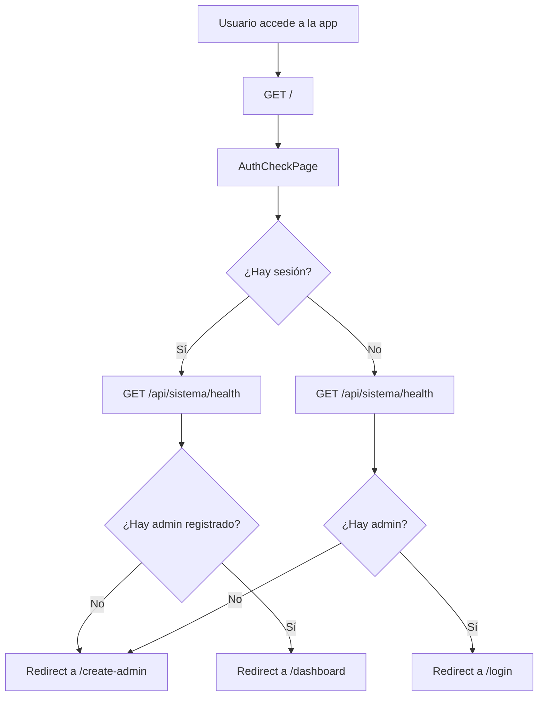

# Enrutamiento

## Estructura de rutas

El router está en `src/app/router/index.jsx` y define las rutas públicas y protegidas:

```jsx
<Routes>
  <Route path="/"               element={<AuthCheckPage />} />      {/* Detecta si hay sesión */}
  <Route path="/login"          element={<LoginPage />} />
  <Route path="/create-admin"   element={<CreateFirstAdminPage />} />
  <Route path="/dashboard"      element={<ProtectedRoute><DashboardPage /></ProtectedRoute>} />
  <Route path="*"               element={<Navigate to="/" replace />} />
</Routes>
```

---

## Rutas protegidas — `ProtectedRoute`

```jsx
// src/app/router/ProtectedRoute.jsx
export const ProtectedRoute = ({ children }) => {
  if (!storage.hasSession()) {
    return <Navigate to="/login" replace />
  }
  return children
}
```

`hasSession()` verifica que existan tanto `antara_user` como `antara_token` en localStorage.

---

## Navegación por secciones (sin rutas anidadas)

> [!IMPORTANT]
> El dashboard implementa navegación por **secciones** sin React Router anidado. No hay rutas como `/dashboard/pistas`. La sección activa se guarda en el estado local de `DashboardPage` y en el query param `?seccion=pistas`.

### Cómo funciona

```jsx
// DashboardPage.jsx
const [activeNav, setActiveNav] = useState(() => {
  const seccion = searchParams.get('seccion')
  return seccion && NAV_ITEMS.some(i => i.id === seccion) ? seccion : 'dashboard'
})

const handleNav = (id) => {
  setActiveNav(id)
  // Actualiza la URL para que el botón atrás funcione
  navigate(id === 'dashboard' ? '/dashboard' : `/dashboard?seccion=${id}`, { replace: true })
}
```

### Renderizado condicional

```jsx
{activeNav === 'rutas' ? (
  <RutasAudioPage onToast={setToast} />
) : activeNav === 'pistas' ? (
  <PistasPage onToast={setToast} onEscanear={() => handleNav('rutas')} />
) : (
  <ComingSoon item={activeItem} />
)}
```

---

## Cómo agregar una nueva ruta pública

En `src/app/router/index.jsx`:

```jsx
import { MiPaginaPublica } from '../../features/mi-feature'

// Dentro de <Routes>:
<Route path="/mi-ruta" element={<MiPaginaPublica />} />
```

---

## Cómo agregar una nueva ruta protegida (página separada)

```jsx
import { MiPaginaProtegida } from '../../features/mi-feature'

<Route
  path="/mi-ruta"
  element={
    <ProtectedRoute>
      <MiPaginaProtegida />
    </ProtectedRoute>
  }
/>
```

---

## Cómo agregar una nueva sección al dashboard

Sin crear una nueva ruta React Router. En `DashboardPage.jsx`:

1. Agrega al array `NAV_ITEMS`
2. Agrega al switch de `activeNav`
3. Actualiza `handleNav` para no mostrar "próximamente"

Ver guía detallada en [features.md → Paso 7](./features.md#paso-7--integrar-en-dashboardpage).

---

## Flujo de autenticación



---

## Limitaciones del sistema de navegación

1. **El botón "atrás" del navegador funciona** porque `handleNav` actualiza la URL, pero no navega a subsecciones reales: siempre regresa al dashboard principal.
2. **No hay lazy loading de secciones.** Todos los features se importan en `DashboardPage` al montar.
3. **El estado de cada sección se destruye al cambiar de sección.** Si el usuario estaba en la mitad de la lista de pistas y navega a rutas y vuelve, la lista se recarga.

---

## ❌ Errores comunes de enrutamiento

- **Crear rutas como `/dashboard/pistas` en React Router.** No es el patrón del proyecto; usa la navegación por secciones del dashboard.
- **Usar `<Link>` de React Router dentro del dashboard para navegar entre secciones.** Usa `handleNav(id)`.
- **Olvidar `replace: true` en la navegación de autenticación.** Sin `replace`, el botón atrás puede volver a una ruta que ya no tiene sentido.
- **Acceder a `/dashboard` sin pasar por `ProtectedRoute`.** El router ya lo protege, pero si añades subrutas directas, asegúrate de envolverlas también.

