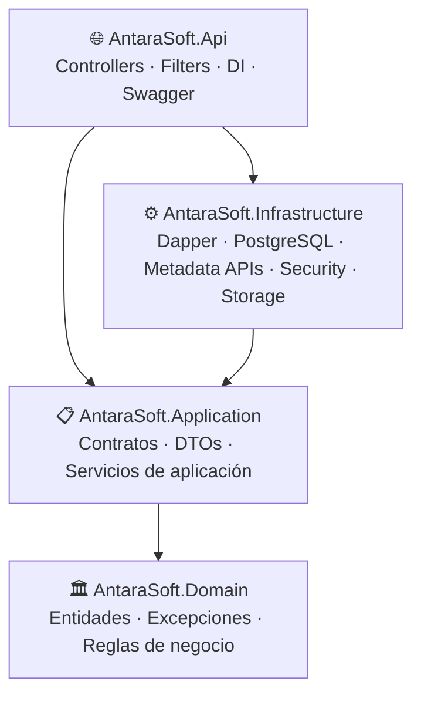
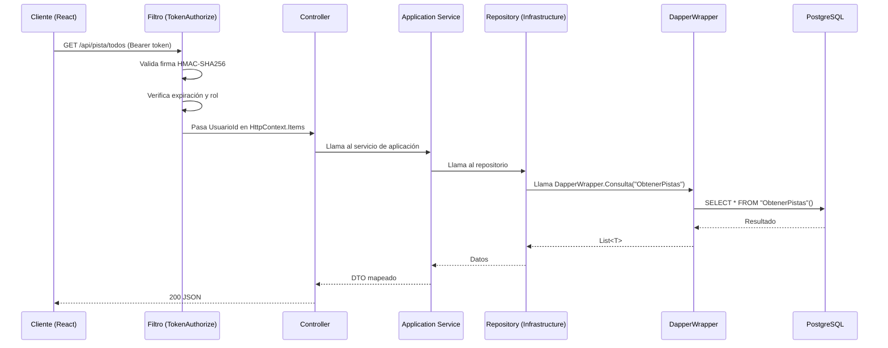

# Arquitectura — AntaraSoft Backend

## Resumen

El backend sigue **Clean Architecture** con cuatro capas bien definidas. La regla de oro es que las dependencias siempre apuntan hacia adentro: el Dominio no depende de nadie, la Aplicación solo conoce el Dominio, la Infraestructura implementa los contratos de la Aplicación, y la API orquesta todo.



---

## Responsabilidades por capa

### 🏛️ Domain (`AntaraSoft.Domain`)

**Contiene:** Entidades, excepciones de dominio.

**No contiene:** SQL, DTOs, configuración HTTP, referencias a Dapper, Npgsql o cualquier framework.

```
AntaraSoft.Domain/
└── Entities/
    ├── Pista.cs
    ├── Usuario.cs
    ├── Album.cs
    ├── Playlist.cs
    ├── PlaylistPista.cs
    └── RutaAudio.cs
└── Exceptions/
    ├── DomainException.cs
    ├── NotFoundException.cs
    ├── ValidationException.cs
    └── ConflictException.cs
```

Las entidades son `record` con propiedades inmutables. Representan conceptos del negocio, no estructuras de base de datos.

---

### 📋 Application (`AntaraSoft.Application`)

**Contiene:** Interfaces de repositorios, interfaces de servicios, DTOs de entrada/salida, implementaciones de servicios de aplicación, extensiones de mapeo.

**No contiene:** SQL, código de Dapper, referencias a HttpClient, lógica de red.

```
AntaraSoft.Application/
├── AppSettings.cs                  ← Modelo de configuración
├── MappingExtensions.cs            ← Métodos .AsDto() en entidades
├── Contracts/
│   ├── Repository/IRepositories.cs ← Contratos de persistencia
│   └── Services/
│       ├── IServices.cs            ← Contratos de servicios
│       └── MetadatosAudio.cs       ← Modelo compartido de metadatos
├── Dtos/
│   └── AllDtos.cs                  ← Todos los DTOs del sistema
└── Services/
    ├── GestionarPistaService.cs
    ├── GestionarAlbumService.cs
    ├── GestionarPlaylistService.cs
    ├── LoginService.cs
    ├── MetadatosPistaService.cs
    ├── RegistrarUsuarioService.cs
    └── SistemaService.cs
```

Los servicios de aplicación **solo coordinan**: validan entradas, llaman repositorios, aplican reglas de negocio simples. No contienen SQL ni lógica de red.

---

### ⚙️ Infrastructure (`AntaraSoft.Infrastructure`)

**Contiene:** Implementaciones de repositorios con Dapper, seguridad (tokens, hashing), almacenamiento de audio, proveedores de metadatos externos, servicios en background.

**No contiene:** Lógica de negocio, DTOs de API, controladores.

```
AntaraSoft.Infrastructure/
├── Persistence/
│   ├── DapperWrapper.cs        ← Wrapper de IDapper (invoca stored procedures)
│   ├── UsuarioRepository.cs
│   ├── PistaRepository.cs
│   ├── AlbumRepository.cs
│   ├── PlaylistRepository.cs
│   ├── RutaAudioRepository.cs
│   ├── BibliotecaRepository.cs
│   └── DashboardRepository.cs
├── Security/
│   ├── EncryptText.cs          ← BCrypt hashing
│   └── TokenService.cs         ← HMAC-SHA256 tokens
├── Storage/
│   ├── HostPathResolver.cs     ← Mapeo Windows → Linux
│   ├── RutaAudioCache.cs       ← Cache en memoria de rutas activas
│   └── AudioStorageService.cs  ← Resolución de rutas físicas de audio
├── Metadata/
│   ├── DeezerMetadataProvider.cs
│   ├── TheAudioDbMetadataProvider.cs
│   ├── MusicBrainzMetadataProvider.cs
│   ├── ItunesMetadataProvider.cs
│   ├── LrcLibMetadataProvider.cs
│   ├── LyricsOvhProvider.cs
│   ├── EnriquecedorMetadatos.cs
│   ├── SimilitudTexto.cs
│   ├── AnalizadorNombreArchivo.cs
│   └── ApiRateLimiter.cs
└── Services/
    ├── RutaAudioService.cs     ← Servicio de gestión de rutas
    └── EscaneoAudioService.cs  ← Escaneo paralelo de biblioteca
```

---

### 🌐 Api (`AntaraSoft.Api`)

**Contiene:** Controladores MVC, filtros de autorización, middleware, configuración de DI (`Program.cs`), inicializador de BD, helpers de upload.

**No contiene:** Lógica de negocio, consultas SQL directas.

```
AntaraSoft.Api/
├── Program.cs              ← Punto de entrada y composición de servicios
├── DatabaseInitializer.cs  ← DDL + stored procedures (auto-ejecutado al iniciar)
├── Extensions.cs           ← Helper para subir archivos a wwwroot/uploads
├── Controllers/
│   ├── UsuarioController.cs
│   ├── PistaController.cs
│   ├── AlbumController.cs
│   ├── PlaylistController.cs
│   ├── RutaAudioController.cs
│   ├── DashboardController.cs
│   ├── SistemaController.cs
│   └── EscaneoAudioController.cs
├── Filters/
│   ├── TokenAuthorizeAttribute.cs  ← Valida token Bearer + roles
│   ├── RoleAuthorizeAttribute.cs   ← Solo valida roles (sin token propio)
│   ├── AdminBootstrapFilter.cs     ← Bloquea API si no hay admin registrado
│   └── AdminBootstrapState.cs      ← Estado singleton del bootstrap
└── appsettings.json
```

---

## Reglas de dependencia

> [!IMPORTANT]
> Estas reglas son absolutas. Violarlas crea acoplamiento incorrecto.

| Capa | Puede depender de | No puede depender de |
|---|---|---|
| **Domain** | Nadie | Todos |
| **Application** | Domain | Infrastructure, Api |
| **Infrastructure** | Application, Domain | Api |
| **Api** | Application, Infrastructure, Domain | — |

---

## Flujo completo de una request



---

## Ciclo de vida de los servicios (DI)

| Tipo | Registrado como | Justificación |
|---|---|---|
| `DapperWrapper` | `Transient` | Crea conexión nueva por operación |
| Repositorios | `Transient` | Alineados con DapperWrapper |
| Servicios de aplicación | `Transient` | Sin estado, sin riesgo |
| `RutaAudioCache` | `Singleton` | Cache compartida en memoria |
| `HostPathResolver` | `Singleton` | Sin estado mutable |
| Proveedores de metadatos | `Singleton` | HttpClient compartido |
| `EscaneoAudioService` | `Singleton` | Gestiona un escaneo activo global |
| `AdminBootstrapState` | `Singleton` | Estado de arranque compartido |

> [!WARNING]
> No registres repositorios o servicios como `Singleton` si dependen de `DapperWrapper`. Cada request debe tener su propia conexión a la base de datos.

---

## ❌ Errores comunes

- **Poner SQL en un servicio de aplicación.** El SQL va exclusivamente en los repositorios de Infrastructure.
- **Devolver entidades de dominio directamente desde un controlador.** Siempre devuelve un DTO (usa los métodos `.AsDto()` de `MappingExtensions`).
- **Agregar una referencia de Infrastructure en Domain.** Domain no conoce nada externo.
- **Inyectar un `Singleton` que depende de un `Transient`.** Produce errores de scope o datos compartidos entre requests.
- **Crear un repositorio sin su interfaz en `IRepositories.cs`.** La interfaz va en Application; la implementación en Infrastructure.

