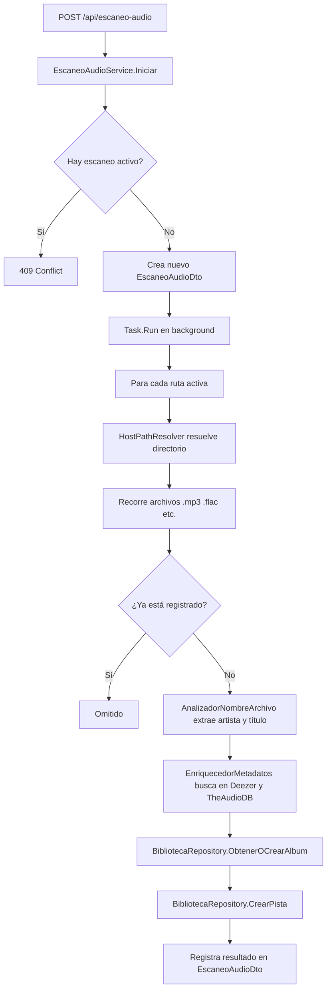

# Almacenamiento de Audio

## HostPathResolver — Mapeo Windows → Linux

El sistema corre en Docker sobre Linux, pero el administrador ingresa rutas de Windows desde el panel (`C:/Users/Leo/Music`). `HostPathResolver` traduce automáticamente estas rutas.

### Mapeo

| Ruta del host (Windows) | Ruta en el contenedor |
|---|---|
| `C:/Users/Leo/Music` | `/host/c/Users/Leo/Music` |
| `F:/Musica` | `/host/f/Musica` |
| `H:/Multimedia/Musica` | `/host/h/Multimedia/Musica` |
| `/music` | `/music` (sin cambio) |

**Volúmenes Docker: dinámicos, no declarados en el compose base.**

`docker-compose.yml` no registra letras de unidad. `scripts/montar-unidades.sh`
enumera las unidades que existen en el host y genera `docker-compose.unidades.yml`
con un bind de solo lectura por cada una:

```yaml
# docker-compose.unidades.yml (generado, no versionado)
services:
  api:
    volumes:
      - type: bind
        source: "C:/"
        target: /host/c
        read_only: true
      - type: bind
        source: "H:/"
        target: /host/h
        read_only: true
```

El stack se levanta con ambos archivos:

```bash
./scripts/montar-unidades.sh            # detecta unidades y hace up -d
./scripts/montar-unidades.sh --build    # reconstruye además las imágenes
```

La API descubre en caliente las unidades realmente montadas leyendo los
directorios de una letra bajo `HostMountRoot`, y las expone en
`GET /api/sistema/unidades-host`, así que el panel no mantiene ninguna lista fija.

> [!IMPORTANT]
> El contenedor solo puede leer unidades montadas. Al conectar un disco nuevo basta con volver a ejecutar `./scripts/montar-unidades.sh`: reescribe el archivo generado y recrea el servicio `api`. No hay que editar el compose ni agregar variables por unidad.
>
> En Linux/macOS no existen letras de unidad: pasa las carpetas con `RUTAS_EXTRA=/mnt/musica ./scripts/montar-unidades.sh` o registra directamente la ruta del contenedor en el panel.

### Configuración

```json
{
  "AppSettings": {
    "HostMountRoot": "/host"
  }
}
```

### Resolución de rutas de archivos individuales

`AudioStorageService.ResolvePhysicalPath(url)` prueba en este orden:

1. Mapea la ruta Windows a contenedor via `HostPathResolver.Mapear()`
2. Si no es Windows, prueba la ruta tal cual (ya es ruta de contenedor)
3. Busca en las `AudioStorageLocations` configuradas

---

## RutaAudioCache

Cache en memoria (`Singleton`) que guarda las rutas de audio activas para que `AudioStorageService` pueda resolver archivos sin consultar la BD en cada request.

```csharp
// Se inicializa en Program.cs al arrancar:
var rutas = await rutaAudioRepository.ObtenerTodas();
rutaAudioCache.Actualizar(rutas.Where(r => r.EstaActiva));

// Se actualiza cuando el usuario crea/edita/elimina una ruta desde el panel
```

> [!NOTE]
> Si modificas rutas de audio directamente en la BD sin pasar por la API, debes reiniciar el contenedor para refrescar la cache.

---

## EscaneoAudioService — Escaneo paralelo

El escaneo recorre todas las rutas activas buscando archivos de audio y los registra en la BD con metadatos obtenidos de los proveedores.

### Flujo del escaneo



### Paralelismo

El escaneo procesa archivos en paralelo con hasta `AppSettings.EscaneoAudioMaxParalelo` tareas simultáneas (defecto: 4).

```json
{
  "AppSettings": {
    "EscaneoAudioMaxParalelo": 4
  }
}
```

### Extensiones de audio soportadas

`.mp3`, `.flac`, `.wav`, `.m4a`, `.aac`, `.ogg`, `.opus`, `.wma`

---

## Subida de canciones (SubidaPistaService)

El panel sube archivos a través de `POST /api/pista/subir` (multipart). El destino
no llega como ruta libre: el cliente envía el `rutaId` de una ruta ya registrada y
el servicio resuelve su carpeta efectiva con `HostPathResolver`.

1. Valida la extensión contra la lista de audio (`.mp3`, `.flac`, `.wav`, `.m4a`,
   `.aac`, `.ogg`, `.opus`, `.wma`, `.aiff`, `.alac`); cualquier otro archivo
   responde `400`.
2. Resuelve la carpeta de la ruta (o de la predeterminada si no se indica) y falla
   si no existe o no es escribible desde el contenedor.
3. Sanitiza la subcarpeta opcional: no admite rutas absolutas ni `..` y debe quedar
   dentro de la carpeta de la ruta.
4. Guarda el archivo sin sobrescribir (`canción (1).mp3`, …) y lo registra en la
   biblioteca llamando a `IEscaneoAudioService.ImportarArchivoAsync`, que reutiliza
   el enriquecido de metadatos del escaneo (álbum, género, portada y letra).

El tamaño máximo por archivo se controla con `AppSettings__SubidaAudioMaxMb`
(2048 MB por defecto) y debe ser coherente con `client_max_body_size` de Nginx.

### Descarga desde YouTube

`POST /api/pista/subir/url` usa `YouTubeAudioDownloader` (`yt-dlp` + `ffmpeg`
instalados en la imagen) para bajar el audio de un enlace y guardarlo en la misma
ruta que una subida normal:

1. Valida que el host sea `youtube.com` o `youtu.be` (subdominios incluidos).
2. Ejecuta `yt-dlp` con `--no-playlist --extract-audio --audio-format mp3` dentro de
   la carpeta de destino; los argumentos van como lista, nunca por shell.
3. Toma la ruta final que imprime `--print after_move:filepath`, le quita el sufijo
   `[id]` y registra la pista con `ImportarArchivoAsync` (metadatos incluidos).

El binario se localiza con `AppSettings__YtDlpPath` y el tiempo máximo con
`AppSettings__DescargaYouTubeTimeoutSegundos` (600 s).

Configuración útil de YouTube:

| Variable | Valor | Para qué |
|---|---|---|
| `YTDLP_PLAYER_CLIENT` | `android` | Evita el bloqueo «Sign in to confirm you're not a bot» en muchas redes. |
| `YTDLP_COOKIES_PATH` | `/config/cookies/youtube.txt` | Cookies Netscape si YouTube exige sesión; se montan desde `./cookies`. |

Los montajes de unidades del host los genera `scripts/montar-unidades.sh` con
escritura; con `UNIDADES_SOLO_LECTURA=1` el panel solo podrá leer, y las subidas a
esas rutas responderán `400`.

---

## AnalizadorNombreArchivo

Extrae artista y título a partir del nombre del archivo, usando patrones comunes:

| Patrón del archivo | Artista extraído | Título extraído |
|---|---|---|
| `Queen - Bohemian Rhapsody.mp3` | `Queen` | `Bohemian Rhapsody` |
| `Bohemian Rhapsody.mp3` | `""` | `Bohemian Rhapsody` |
| `01 - Bohemian Rhapsody.mp3` | `""` | `Bohemian Rhapsody` |

Si no puede separar artista y título, usa el nombre completo del archivo (sin extensión) como título.

---

## Streaming de audio

El endpoint `GET /api/pista/{id}` sirve el archivo de audio directamente:

1. Resuelve la ruta física con `IAudioStorage.ResolvePhysicalPath(pista.Url)`
2. Verifica que el archivo existe (`File.Exists`)
3. Devuelve `PhysicalFile(filePath, contentType, enableRangeProcessing: true)`

El `enableRangeProcessing: true` habilita el seek (el frontend puede pedir rangos de bytes para saltar en la canción).

---

## ❌ Errores comunes

- **Ingresar una ruta que no está montada en Docker.** El archivo no existe desde el contenedor. Usa el botón "Probar ruta" antes de escanear.
- **Olvidar reiniciar la API después de agregar una ruta.** La `RutaAudioCache` se inicializa al arrancar. Las rutas nuevas se agregan dinámicamente al guardar, pero el cache de rutas activas para resolución de archivos se actualiza en la operación de guardado.
- **Archivos con caracteres especiales en el nombre.** `AnalizadorNombreArchivo` puede fallar con algunos caracteres en el separador. El sistema lo maneja como error y registra la pista sin artista/título.
- **Iniciar un segundo escaneo mientras hay uno activo.** Devuelve `409`. Solo puede haber un escaneo global activo a la vez.

