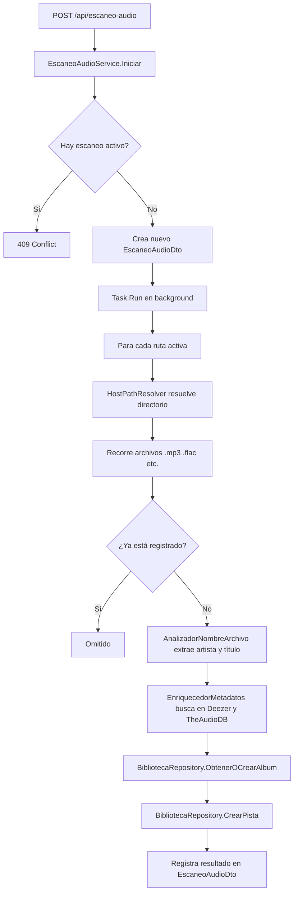

# Almacenamiento de Audio

## HostPathResolver — Mapeo Windows → Linux

El sistema corre en Docker sobre Linux, pero el administrador ingresa rutas de Windows desde el panel (`C:/Users/Leo/Music`). `HostPathResolver` traduce automáticamente estas rutas.

### Mapeo

| Ruta del host (Windows) | Ruta en el contenedor |
|---|---|
| `C:/Users/Leo/Music` | `/host/c/Users/Leo/Music` |
| `D:/Flac` | `/host/d/Flac` |
| `/music` | `/music` (sin cambio) |

**Volumen Docker correspondiente** (en `docker-compose.yml`):
```yaml
volumes:
  - type: bind
    source: "C:/"
    target: /host/c
    read_only: true
```

> [!IMPORTANT]
> El contenedor solo puede leer unidades montadas en `docker-compose.yml`. Si el usuario tiene música en `E:/`, debes agregar un nuevo volumen bind para `E:/`.

### Configuración

```json
{
  "AppSettings": {
    "HostMountRoot": "/host"
  }
}
```

### Resolución de rutas de archivos individuales

`AudioStorageService.ResolvePhysicalPath(url)` prueba en este orden:

1. Mapea la ruta Windows a contenedor via `HostPathResolver.Mapear()`
2. Si no es Windows, prueba la ruta tal cual (ya es ruta de contenedor)
3. Busca en las `AudioStorageLocations` configuradas

---

## RutaAudioCache

Cache en memoria (`Singleton`) que guarda las rutas de audio activas para que `AudioStorageService` pueda resolver archivos sin consultar la BD en cada request.

```csharp
// Se inicializa en Program.cs al arrancar:
var rutas = await rutaAudioRepository.ObtenerTodas();
rutaAudioCache.Actualizar(rutas.Where(r => r.EstaActiva));

// Se actualiza cuando el usuario crea/edita/elimina una ruta desde el panel
```

> [!NOTE]
> Si modificas rutas de audio directamente en la BD sin pasar por la API, debes reiniciar el contenedor para refrescar la cache.

---

## EscaneoAudioService — Escaneo paralelo

El escaneo recorre todas las rutas activas buscando archivos de audio y los registra en la BD con metadatos obtenidos de los proveedores.

### Flujo del escaneo



### Paralelismo

El escaneo procesa archivos en paralelo con hasta `AppSettings.EscaneoAudioMaxParalelo` tareas simultáneas (defecto: 4).

```json
{
  "AppSettings": {
    "EscaneoAudioMaxParalelo": 4
  }
}
```

### Extensiones de audio soportadas

`.mp3`, `.flac`, `.wav`, `.m4a`, `.aac`, `.ogg`, `.opus`, `.wma`

---

## AnalizadorNombreArchivo

Extrae artista y título a partir del nombre del archivo, usando patrones comunes:

| Patrón del archivo | Artista extraído | Título extraído |
|---|---|---|
| `Queen - Bohemian Rhapsody.mp3` | `Queen` | `Bohemian Rhapsody` |
| `Bohemian Rhapsody.mp3` | `""` | `Bohemian Rhapsody` |
| `01 - Bohemian Rhapsody.mp3` | `""` | `Bohemian Rhapsody` |

Si no puede separar artista y título, usa el nombre completo del archivo (sin extensión) como título.

---

## Streaming de audio

El endpoint `GET /api/pista/{id}` sirve el archivo de audio directamente:

1. Resuelve la ruta física con `IAudioStorage.ResolvePhysicalPath(pista.Url)`
2. Verifica que el archivo existe (`File.Exists`)
3. Devuelve `PhysicalFile(filePath, contentType, enableRangeProcessing: true)`

El `enableRangeProcessing: true` habilita el seek (el frontend puede pedir rangos de bytes para saltar en la canción).

---

## ❌ Errores comunes

- **Ingresar una ruta que no está montada en Docker.** El archivo no existe desde el contenedor. Usa el botón "Probar ruta" antes de escanear.
- **Olvidar reiniciar la API después de agregar una ruta.** La `RutaAudioCache` se inicializa al arrancar. Las rutas nuevas se agregan dinámicamente al guardar, pero el cache de rutas activas para resolución de archivos se actualiza en la operación de guardado.
- **Archivos con caracteres especiales en el nombre.** `AnalizadorNombreArchivo` puede fallar con algunos caracteres en el separador. El sistema lo maneja como error y registra la pista sin artista/título.
- **Iniciar un segundo escaneo mientras hay uno activo.** Devuelve `409`. Solo puede haber un escaneo global activo a la vez.

