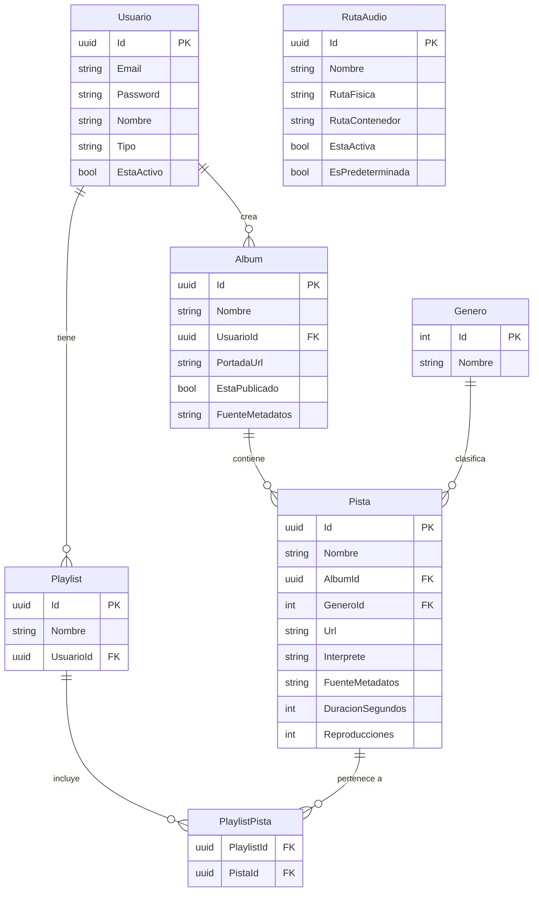

# Modelo de Dominio

## Entidades

Todas las entidades están en `AntaraSoft.Domain/Entities/` y son `record` de C# (inmutables por defecto, con soporte para `with` expressions).

---

### `Usuario`

Representa a un usuario del sistema. Los tipos `admin` y `administrador` tienen acceso completo.

| Campo | Tipo | Descripción |
|---|---|---|
| `Id` | `Guid` | Identificador único (UUID v4) |
| `Email` | `string` | Email único, usado para login |
| `Password` | `string` | Hash BCrypt de la contraseña |
| `Nombre` | `string` | Nombre completo |
| `FechaNacimiento` | `DateTime` | Fecha de nacimiento |
| `Genero` | `char` | `'M'`, `'F'` u otro carácter |
| `EstaActivo` | `bool` | Si la cuenta está habilitada |
| `FechaRegistro` | `DateTime` | Cuándo se creó la cuenta |
| `Pais` | `string` | País del usuario |
| `FotoPerfil` | `string` | URL de la foto de perfil |
| `Tipo` | `string` | Rol: `"admin"` o `"administrador"` |

---

### `Pista`

Representa un archivo de audio en la biblioteca.

| Campo | Tipo | Descripción |
|---|---|---|
| `Id` | `Guid` | Identificador único |
| `Nombre` | `string` | Título de la canción |
| `FechaRegistro` | `DateTime` | Cuándo se registró en el sistema |
| `AnoCreacion` | `int` | Año de lanzamiento |
| `Interprete` | `string` | Artista o intérprete |
| `Compositor` | `string` | Compositor (opcional) |
| `Productor` | `string` | Productor (opcional) |
| `Reproducciones` | `int` | Contador de reproducciones |
| `GeneroId` | `int` | FK → tabla `Genero` |
| `Url` | `string` | Ruta física o URL del archivo de audio |
| `AlbumId` | `Guid` | FK → `Album` |
| `EstaActivo` | `bool` | Si la pista está visible |
| `Letra` | `string` | Letra de la canción (obtenida de Lyrics.OVH) |
| `ImagenArtista` | `string` | URL de imagen del artista |
| `DuracionSegundos` | `int` | Duración en segundos |
| `FuenteMetadatos` | `string` | `"deezer"` o `"theaudiodb"` |
| `IdExternoMetadatos` | `string` | ID en el proveedor externo |
| `PortadaUrl` | `string` | URL de la portada del álbum |

---

### `Album`

Agrupa pistas. Puede ser creado por el administrador o resolverse automáticamente durante el escaneo.

| Campo | Tipo | Descripción |
|---|---|---|
| `Id` | `Guid` | Identificador único |
| `Nombre` | `string` | Nombre del álbum |
| `Descripcion` | `string` | Descripción opcional |
| `EstaPublicado` | `bool` | Si está publicado |
| `FechaPublicacion` | `DateTime?` | Cuándo se publicó |
| `PortadaUrl` | `string` | URL de la portada |
| `UsuarioId` | `Guid` | FK → `Usuario` creador |
| `EstaActivo` | `bool` | Si está activo |
| `Artista` | `string` | Artista principal del álbum |
| `FuenteMetadatos` | `string` | Fuente de los metadatos |
| `IdExternoMetadatos` | `string` | ID en el proveedor externo |

---

### `Playlist`

Lista de reproducción de un usuario.

| Campo | Tipo | Descripción |
|---|---|---|
| `Id` | `Guid` | Identificador único |
| `Nombre` | `string` | Nombre de la playlist |
| `Descripcion` | `string` | Descripción opcional |
| `UsuarioId` | `Guid` | FK → `Usuario` propietario |
| `PortadaUrl` | `string` | URL de imagen de portada |
| `EstaActivo` | `bool` | Si está activa |

---

### `PlaylistPista`

Relación muchos-a-muchos entre Playlist y Pista.

| Campo | Tipo | Descripción |
|---|---|---|
| `PlaylistId` | `Guid` | FK → `Playlist` |
| `PistaId` | `Guid` | FK → `Pista` |

---

### `RutaAudio`

Carpeta del sistema de archivos donde el servidor busca archivos de audio.

| Campo | Tipo | Descripción |
|---|---|---|
| `Id` | `Guid` | Identificador único |
| `Nombre` | `string` | Nombre descriptivo |
| `RutaFisica` | `string` | Ruta en el host (ej: `C:/Music`) |
| `RutaContenedor` | `string` | Ruta dentro del contenedor (ej: `/music`) |
| `Descripcion` | `string` | Descripción opcional |
| `EstaActiva` | `bool` | Si se escanea activamente |
| `EsPredeterminada` | `bool` | Ruta principal del sistema |
| `FechaRegistro` | `DateTime` | Cuándo se agregó |
| `FechaActualizacion` | `DateTime?` | Última modificación |

---

## Diagrama ER

---

## Excepciones de dominio

Las excepciones están en `AntaraSoft.Domain/Exceptions/` y deben usarse cuando una regla de negocio se viola en el dominio o la capa de aplicación.

| Excepción | Uso | HTTP equivalente |
|---|---|---|
| `DomainException` | Base de todas las excepciones de dominio | 400 |
| `NotFoundException` | El recurso solicitado no existe | 404 |
| `ValidationException` | Datos de entrada inválidos | 400 |
| `ConflictException` | Conflicto de estado (duplicado, etc.) | 409 |

> [!TIP]
> Los controladores capturan estas excepciones y devuelven el código HTTP correcto automáticamente. No uses `throw new Exception("mensaje")` genérico desde los servicios.

---

## Reglas de negocio implementadas

1. **El email debe ser único** — `IUsuarioRepository.VerificarEmailUnico()` se llama antes de crear un usuario.
2. **Solo puede existir una ruta predeterminada** — `IRutaAudioRepository.QuitarPredeterminada()` se llama al establecer una nueva.
3. **Las pistas requieren URL o ruta física** — Validado en `PistaController` antes de llamar al servicio.
4. **El primer usuario debe ser administrador** — Enforced por `AdminBootstrapFilter` (bloquea todos los endpoints excepto `/api/sistema/*` hasta que exista un admin).
5. **El token expira** — Configurado en `AppSettings.TokenExpiracionHoras` (defecto: 8 horas).
6. **Los metadatos son opcionales** — Si Deezer y TheAudioDB fallan, la pista se registra sin metadatos.
7. **La letra es opcional** — Si LyricsOvh falla, la pista se registra sin letra.

---

## ❌ Errores comunes

- **Crear una entidad con un constructor con parámetros.** Las entidades son `record` y se crean con inicializadores de objeto (`new Pista { Id = ..., Nombre = ... }`).
- **Agregar lógica de validación SQL en la entidad.** Las entidades no conocen la BD.
- **Usar `int` como ID.** Todos los IDs primarios son `Guid` (excepto `GeneroId` que es `int` por diseño heredado).
- **Modificar una entidad directamente.** Usa `with` expressions: `var pistaEditada = pista with { Nombre = nuevoNombre }`.

