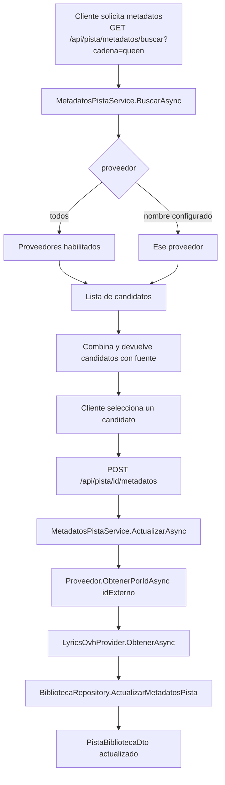

# Sistema de Metadatos

## Flujo de búsqueda y enriquecimiento



---

## Proveedores: instancias configurables

Los proveedores **no** están registrados en el código. `AppSettings:MetadatosProveedores`
es una lista y cada entrada describe una instancia:

| Campo | Uso |
|---|---|
| `Nombre` | Identificador que usan la API y el panel (`?proveedor=deezer`) |
| `Etiqueta` | Nombre visible en el selector del panel |
| `Tipo` | Adaptador que interpreta la respuesta: `deezer`, `theaudiodb`, `musicbrainz`, `itunes`, `lrclib` |
| `BaseUrl` | URL base del API (permite espejos o versiones distintas) |
| `ApiKey` | Clave del API, si el proveedor la requiere |
| `Prioridad` | Menor se consulta primero durante el escaneo |
| `Habilitado` | Si es `false`, la instancia no se carga |

`LetrasProveedor` sigue el mismo criterio para la letra (`Tipo`, `BaseUrl`,
`Habilitado`).

---

## Adaptadores disponibles

### Adaptador Deezer (`DeezerMetadataProvider`)

- **API base:** `https://api.deezer.com`
- **Búsqueda:** `GET /search?q={consulta}&limit=10`
- **Por ID:** `GET /track/{id}`
- **Datos obtenidos:** título, artista, álbum, portada, año (desde `release_date`), género (traducido desde `genre_id`), duración

**Rate limiting:** Implementado con `ApiRateLimiter` (ver más abajo).

---

### Adaptador TheAudioDB (`TheAudioDbMetadataProvider`)

- **API base por defecto:** `https://www.theaudiodb.com/api/v1/json/123` (configurable por instancia)
- **Búsqueda:** `GET /searchtrack.php?s={artista}&t={titulo}` (busca por nombre separado)
- **Por ID:** `GET /track.php?h={id}`
- **Datos obtenidos:** título, artista, álbum, portada (thumbnail), año, género, imagen del artista

> [!NOTE]
> TheAudioDB requiere artista y título separados para buscar. Si la consulta es una cadena libre, el proveedor la divide por el primer espacio o usa heurística para separar artista y título.

---

### Adaptador MusicBrainz (`MusicBrainzMetadataProvider`)

- **API base por defecto:** `https://musicbrainz.org` (instancia configurable; por defecto también usa Cover Art Archive)
- **Búsqueda:** `GET /ws/2/recording?query=recording:"..." AND artist:"..."&fmt=json`
- **Por ID:** `GET /ws/2/recording/{id}?inc=artist-credits+releases+genres+isrcs&fmt=json`
- **Portada:** `HEAD https://coverartarchive.org/release/{id}/front-500` (solo se devuelve si existe; Cover Art Archive responde 404 cuando el lanzamiento no tiene arte)
- **Datos obtenidos:** título, artistas (artist-credit), álbum y fecha de lanzamiento, año, género/tag, duración, ISRC y portada

> [!NOTE]
> MusicBrainz no requiere clave ni registro, pero pide un máximo de **1 petición por segundo** y un `User-Agent` identificable. El limitador del adaptador ya usa 1100 ms y el cliente `metadatos` envía `Antara/1.0`.

---

### Adaptador iTunes (`ItunesMetadataProvider`)

- **API base por defecto:** `https://itunes.apple.com`
- **Búsqueda:** `GET /search?term={consulta}&media=music&entity=song&limit=8`
- **Por ID:** `GET /lookup?id={trackId}&entity=song`
- **Datos obtenidos:** título, artista, álbum, género, año, duración y portada en 600×600 (la URL viene como `100x100bb` y se reescala)

> [!NOTE]
> La Search API de iTunes es gratuita y sin clave, pero Apple limita a unas **20 peticiones por minuto**; el adaptador espera 1,5 s entre llamadas. El catálogo depende de la tienda regional del servidor (por defecto, Estados Unidos).

---

### Adaptador LRCLIB (`LrcLibMetadataProvider`)

- **API base por defecto:** `https://lrclib.net` (configurable por instancia)
- **Búsqueda:** `GET /api/search?track_name={titulo}&artist_name={artista}` (máximo 20 resultados; el buscador libre del panel usa `GET /api/search?q={consulta}`)
- **Por ID:** `GET /api/get/{id}`
- **Firma exacta:** `GET /api/get?artist_name=...&track_name=...&album_name=...&duration=...` (la usa el endpoint de letra sincronizada; la duración debe coincidir con ±2 s)
- **Datos obtenidos:** título, artista, álbum, duración y letra plana (`plainLyrics`); también informa si existe letra sincronizada (`syncedLyrics`) y si la pista es instrumental

> [!NOTE]
> LRCLIB no requiere clave ni registro y no publica portadas, género ni año. Sus límites aproximados son **45 peticiones/minuto** para clientes genéricos y **90** para clientes identificados; el adaptador espera 350 ms entre llamadas, envía el `User-Agent` de `Antara/1.0` y respeta `Retry-After` cuando recibe `429`.

---

### Adaptador Lyrics.OVH (`LyricsOvhProvider`)

- **API base por defecto:** `https://api.lyrics.ovh` (configurable en `LetrasProveedor:BaseUrl`)
- **Endpoint:** `GET /v1/{artista}/{titulo}`
- **Datos obtenidos:** letra de la canción en texto plano

La letra es **opcional**. Si falla (canción no encontrada, timeout, error de red), el sistema continúa sin letra.

---

## EnriquecedorMetadatos

Clase orquestadora que combina proveedores de metadatos + proveedor de letras:

```csharp
// Comportamiento:
// 1. Itera por los proveedores en el orden de Prioridad de la configuración
// 2. Si un proveedor devuelve Encontrado = true, lo usa y deja de iterar
// 3. Si todos fallan, devuelve MetadatosAudio con Encontrado = false
// 4. Intentar obtener la letra (siempre, independientemente del éxito de metadatos)
// 5. Si la letra falla, continúa sin error
```

---

## ApiRateLimiter

Limita la velocidad de solicitudes a APIs externas para evitar bloqueos.

```csharp
// Uso en un proveedor:
await _rateLimiter.EsperarAsync(cancellationToken);
// Luego hacer la solicitud HTTP
```

El rate limiter usa un `SemaphoreSlim` con un intervalo configurable entre requests.

---

## Cómo agregar un nuevo proveedor de metadatos

### Caso 1 — Otra instancia de un adaptador existente (sin código)

Basta con agregar una entrada a `AppSettings:MetadatosProveedores`. Por ejemplo,
un espejo de Deezer en segundo plano, o TheAudioDB antes que Deezer:

```json
{
  "Nombre": "deezer-espejo",
  "Etiqueta": "Deezer (espejo)",
  "Tipo": "deezer",
  "BaseUrl": "https://espejo.ejemplo.com",
  "Prioridad": 2,
  "Habilitado": true
}
```

En Docker se agrega al compose con el siguiente índice:

```yaml
AppSettings__MetadatosProveedores__2__Nombre: deezer-espejo
AppSettings__MetadatosProveedores__2__Etiqueta: Deezer (espejo)
AppSettings__MetadatosProveedores__2__Tipo: deezer
AppSettings__MetadatosProveedores__2__BaseUrl: https://espejo.ejemplo.com
AppSettings__MetadatosProveedores__2__Prioridad: 2
AppSettings__MetadatosProveedores__2__Habilitado: "true"
```

Reinicia la API: el proveedor aparece en el selector del panel (que se llena con
`GET /api/pista/metadatos/proveedores`) y participa en el escaneo según su prioridad.

### Caso 2 — Un API con formato distinto (nuevo adaptador)

1. **Crea el adaptador** en `AntaraSoft.Infrastructure/Metadata/`, implementando
   `IMetadataProvider` con constructor `(IHttpClientFactory, AppSettings, ProveedorMetadatosConfig)`:

```csharp
public class MiProveedorMetadataProvider : IMetadataProvider
{
    public MiProveedorMetadataProvider(
        IHttpClientFactory httpClientFactory,
        AppSettings settings,
        ProveedorMetadatosConfig config) { /* … */ }

    public string Nombre => _config.Nombre;
    public string Etiqueta => string.IsNullOrWhiteSpace(_config.Etiqueta) ? Nombre : _config.Etiqueta;

    public Task<MetadatosAudio> BuscarAsync(
        string artista, string titulo, string carpeta,
        CancellationToken cancellationToken) { /* … */ }

    public Task<List<MetadatosAudio>> BuscarCandidatosAsync(
        string consulta, CancellationToken cancellationToken) { /* … */ }

    public Task<MetadatosAudio> ObtenerPorIdAsync(
        string idExterno, CancellationToken cancellationToken) { /* … */ }
}
```

2. **Agrega el `case` en `Program.cs`**, junto a `deezer` y `theaudiodb`:

```csharp
case "miproveedor":
    builder.Services.AddSingleton<IMetadataProvider>(sp => new MiProveedorMetadataProvider(
        sp.GetRequiredService<IHttpClientFactory>(), appSettingsInicial, configurado));
    break;
```

> [!IMPORTANT]
> El orden de consulta lo define `Prioridad`, no el orden de registro. El panel no
> requiere cambios: su selector se construye con la lista de proveedores que expone la API.

---

## Modelo `MetadatosAudio`

```csharp
public class MetadatosAudio
{
    public bool Encontrado { get; set; }
    public string IdExterno { get; set; }
    public string Fuente { get; set; }        // Nombre del proveedor configurado
    public string Titulo { get; set; }
    public string ArtistaPrincipal { get; set; }
    public string NombreAlbum { get; set; }
    public string PortadaUrl { get; set; }
    public string ImagenArtista { get; set; }
    public int Ano { get; set; }
    public int DuracionSegundos { get; set; }
    public string Genero { get; set; }
    public string Letra { get; set; }
}
```

---

## Configuración en appsettings.json

```json
{
  "AppSettings": {
    "MetadatosTimeoutSegundos": 20,
    "MetadatosProveedores": [
      {
        "Nombre": "deezer",
        "Etiqueta": "Deezer",
        "Tipo": "deezer",
        "BaseUrl": "https://api.deezer.com",
        "Prioridad": 0,
        "Habilitado": true
      },
      {
        "Nombre": "theaudiodb",
        "Etiqueta": "TheAudioDB",
        "Tipo": "theaudiodb",
        "BaseUrl": "https://www.theaudiodb.com/api/v1/json/123",
        "ApiKey": "123",
        "Prioridad": 1,
        "Habilitado": true
      },
      {
        "Nombre": "musicbrainz",
        "Etiqueta": "MusicBrainz",
        "Tipo": "musicbrainz",
        "BaseUrl": "https://musicbrainz.org",
        "Prioridad": 2,
        "Habilitado": true
      },
      {
        "Nombre": "itunes",
        "Etiqueta": "iTunes",
        "Tipo": "itunes",
        "BaseUrl": "https://itunes.apple.com",
        "Prioridad": 3,
        "Habilitado": true
      },
      {
        "Nombre": "lrclib",
        "Etiqueta": "LRCLIB",
        "Tipo": "lrclib",
        "BaseUrl": "https://lrclib.net",
        "Prioridad": 4,
        "Habilitado": true
      }
    ],
    "LetrasProveedor": {
      "Tipo": "lyricsovh",
      "BaseUrl": "https://api.lyrics.ovh",
      "Habilitado": true
    }
  }
}
```

Si `MetadatosProveedores` no se define, la API usa los cinco proveedores
predeterminados (`AppSettings.Predeterminados()`: Deezer, TheAudioDB, MusicBrainz,
iTunes y LRCLIB). Un `Tipo` desconocido se omite
con un aviso en stderr, sin impedir el arranque.

### Reemplazar la lista completa desde una variable de entorno

`METADATOS_PROVEEDORES_JSON` (definida en `.env`, ya la pasa el compose) reemplaza
toda la lista y tiene prioridad sobre `AppSettings:MetadatosProveedores`. Con ella
se agrega, deshabilita o reordena cualquier número de instancias sin editar el
compose ni recompilar:

```bash
METADATOS_PROVEEDORES_JSON='[
  {"Nombre":"deezer","Etiqueta":"Deezer","Tipo":"deezer","BaseUrl":"https://api.deezer.com","Prioridad":0,"Habilitado":true},
  {"Nombre":"deezer-alt","Etiqueta":"Deezer (espejo)","Tipo":"deezer","BaseUrl":"https://api.deezer.com","Prioridad":1,"Habilitado":true},
  {"Nombre":"theaudiodb","Etiqueta":"TheAudioDB","Tipo":"theaudiodb","BaseUrl":"https://www.theaudiodb.com/api/v1/json/123","ApiKey":"123","Prioridad":2,"Habilitado":true}
]'
```

Un JSON inválido se registra en stderr y se ignora, conservando la configuración de
`appsettings.json`. Los cambios se aplican al recrear el contenedor
(`docker compose up -d api`); no requieren rebuild.

### Consulta de proveedores

```http
GET /api/pista/metadatos/proveedores
Authorization: Bearer {token admin}
```

```json
[
  { "nombre": "deezer", "etiqueta": "Deezer" },
  { "nombre": "theaudiodb", "etiqueta": "TheAudioDB" }
]
```

Es la fuente del selector en `ModalMetadatos.jsx`; el frontend no tiene lista propia
de proveedores.

El `HttpClient` para metadatos se registra con nombre `"metadatos"` y tiene un timeout de 60 segundos (configurable). El timeout de cada operación individual es `MetadatosTimeoutSegundos`.

---

## ❌ Errores comunes

- **No implementar `ObtenerPorIdAsync`.** Se llama al aplicar metadatos desde el frontend. Lanza `NotImplementedException` en runtime.
- **Devolver `null` desde `BuscarCandidatosAsync`.** Siempre devuelve `List<MetadatosAudio>` vacía si no hay resultados.
- **Usar un `Tipo` sin adaptador.** La instancia no se registra (aviso en stderr), así que no aparece en el selector ni en el escaneo. Los `Tipo` válidos son `deezer`, `theaudiodb`, `musicbrainz`, `itunes` y `lrclib`.
- **Pedir un proveedor no habilitado por nombre.** `GET /api/pista/metadatos/buscar?proveedor=x` responde `400` con la lista de proveedores disponibles; no cae silenciosamente a "todos".
- **No manejar `OperationCanceledException` en el proveedor.** Debe propagarse para que el escaneo pueda cancelarse correctamente.

