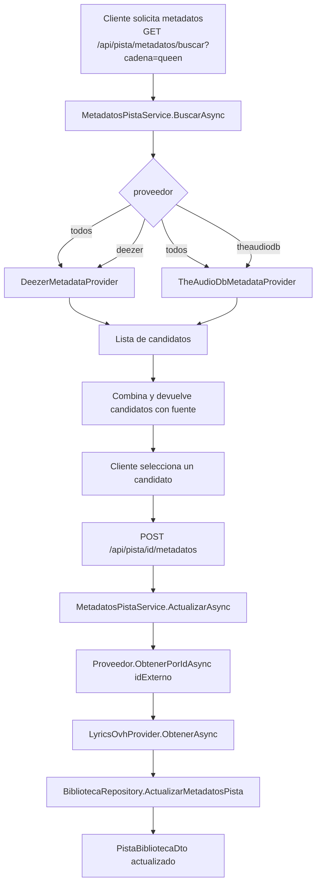

# Sistema de Metadatos

## Flujo de búsqueda y enriquecimiento



---

## Proveedores disponibles

### Deezer (`DeezerMetadataProvider`)

- **API base:** `https://api.deezer.com`
- **Búsqueda:** `GET /search?q={consulta}&limit=10`
- **Por ID:** `GET /track/{id}`
- **Datos obtenidos:** título, artista, álbum, portada, año (desde `release_date`), género (traducido desde `genre_id`), duración

**Rate limiting:** Implementado con `ApiRateLimiter` (ver más abajo).

---

### TheAudioDB (`TheAudioDbMetadataProvider`)

- **API base:** `https://www.theaudiodb.com/api/v1/json/123`
- **Búsqueda:** `GET /searchtrack.php?s={artista}&t={titulo}` (busca por nombre separado)
- **Por ID:** `GET /track.php?h={id}`
- **Datos obtenidos:** título, artista, álbum, portada (thumbnail), año, género, imagen del artista

> [!NOTE]
> TheAudioDB requiere artista y título separados para buscar. Si la consulta es una cadena libre, el proveedor la divide por el primer espacio o usa heurística para separar artista y título.

---

### Lyrics.OVH (`LyricsOvhProvider`)

- **API base:** `https://api.lyrics.ovh`
- **Endpoint:** `GET /v1/{artista}/{titulo}`
- **Datos obtenidos:** letra de la canción en texto plano

La letra es **opcional**. Si falla (canción no encontrada, timeout, error de red), el sistema continúa sin letra.

---

## EnriquecedorMetadatos

Clase orquestadora que combina proveedores de metadatos + proveedor de letras:

```csharp
// Comportamiento:
// 1. Itera por los proveedores de metadatos en orden de registro (Deezer primero, TheAudioDB segundo)
// 2. Si un proveedor devuelve Encontrado = true, lo usa y deja de iterar
// 3. Si todos fallan, devuelve MetadatosAudio con Encontrado = false
// 4. Intentar obtener la letra (siempre, independientemente del éxito de metadatos)
// 5. Si la letra falla, continúa sin error
```

---

## ApiRateLimiter

Limita la velocidad de solicitudes a APIs externas para evitar bloqueos.

```csharp
// Uso en un proveedor:
await _rateLimiter.EsperarAsync(cancellationToken);
// Luego hacer la solicitud HTTP
```

El rate limiter usa un `SemaphoreSlim` con un intervalo configurable entre requests.

---

## Cómo agregar un nuevo proveedor de metadatos

1. **Crea la clase** en `AntaraSoft.Infrastructure/Metadata/`:

```csharp
public class MiProveedorMetadataProvider : IMetadataProvider
{
    public string Nombre => "miproveedor";

    public async Task<MetadatosAudio> BuscarAsync(
        string artista, string titulo, string carpeta,
        CancellationToken cancellationToken)
    {
        // Llama a la API externa
        // Devuelve MetadatosAudio con Encontrado = true si hay resultado
        // Devuelve null o MetadatosAudio con Encontrado = false si no hay resultado
    }

    public async Task<List<MetadatosAudio>> BuscarCandidatosAsync(
        string consulta, CancellationToken cancellationToken)
    {
        // Lista de candidatos para mostrar al usuario
    }

    public async Task<MetadatosAudio> ObtenerPorIdAsync(
        string idExterno, CancellationToken cancellationToken)
    {
        // Obtiene los metadatos completos por ID externo del proveedor
    }
}
```

2. **Registra en `Program.cs`:**

```csharp
builder.Services.AddSingleton<IMetadataProvider, MiProveedorMetadataProvider>();
```

> [!IMPORTANT]
> El orden de registro determina la prioridad en `EnriquecedorMetadatos`. El primer proveedor registrado se consulta primero durante el escaneo automático.

3. **Agrega el nombre al selector del frontend** en `ModalMetadatos.jsx`:

```jsx
{ id: 'miproveedor', label: 'MiProveedor' }
```

---

## Modelo `MetadatosAudio`

```csharp
public class MetadatosAudio
{
    public bool Encontrado { get; set; }
    public string IdExterno { get; set; }
    public string Fuente { get; set; }        // "deezer", "theaudiodb", etc.
    public string Titulo { get; set; }
    public string ArtistaPrincipal { get; set; }
    public string NombreAlbum { get; set; }
    public string PortadaUrl { get; set; }
    public string ImagenArtista { get; set; }
    public int Ano { get; set; }
    public int DuracionSegundos { get; set; }
    public string Genero { get; set; }
    public string Letra { get; set; }
}
```

---

## Configuración en appsettings.json

```json
{
  "AppSettings": {
    "DeezerApiBase": "https://api.deezer.com",
    "TheAudioDbApiBase": "https://www.theaudiodb.com/api/v1/json/123",
    "TheAudioDbApiKey": "123",
    "LetrasApiBase": "https://api.lyrics.ovh",
    "MetadatosTimeoutSegundos": 20
  }
}
```

El `HttpClient` para metadatos se registra con nombre `"metadatos"` y tiene un timeout de 60 segundos (configurable). El timeout de cada operación individual es `MetadatosTimeoutSegundos`.

---

## ❌ Errores comunes

- **No implementar `ObtenerPorIdAsync`.** Se llama al aplicar metadatos desde el frontend. Lanza `NotImplementedException` en runtime.
- **Devolver `null` desde `BuscarCandidatosAsync`.** Siempre devuelve `List<MetadatosAudio>` vacía si no hay resultados.
- **Olvidar registrar el proveedor en `Program.cs`.** No aparecerá en el selector del frontend ni en el escaneo.
- **No manejar `OperationCanceledException` en el proveedor.** Debe propagarse para que el escaneo pueda cancelarse correctamente.

